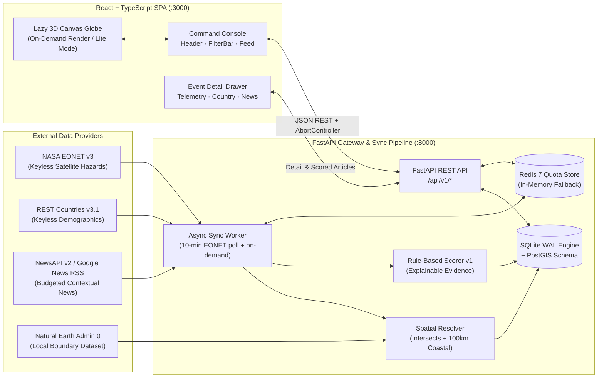

# EARTH EMDS — Earth Event & Disaster Monitoring System

An integrated, open-access situational monitoring and educational web platform that unifies live **NASA EONET v3** satellite hazard telemetry, **Natural Earth Admin 0** spatial country resolution, **REST Countries v3.1** macro-level demographics, and transparent rule-based **NewsAPI v2** media discovery on an interactive **On-Demand 3D Virtual Globe** and keyboard-accessible command console.

> **Educational & Informational Use Boundary**
> This platform is strictly an informational monitoring and educational learning system. It is **not** an emergency alerting, disaster prediction, casualty estimation, evacuation routing, or incident command service.

---

## Table of Contents

- [Key Capabilities](#key-capabilities)
- [System Architecture](#system-architecture)
- [Tech Stack](#tech-stack)
- [Domain Accuracy & Explainability](#domain-accuracy--explainability)
- [Quick Start](#quick-start)
- [Environment Configuration](#environment-configuration)
- [REST API Reference](#rest-api-reference)
- [Keyboard Shortcuts & Accessibility](#keyboard-shortcuts--accessibility)
- [Testing & Verification](#testing--verification)
- [Security & Resilience](#security--resilience)
- [Mandatory Data Uncertainty Disclaimers](#mandatory-data-uncertainty-disclaimers)
- [Repository Structure](#repository-structure)
- [Project Team](#project-team)

---

## Key Capabilities

- **Multi-Geometry Satellite Telemetry (NASA EONET v3):** Concurrently ingests open and recent closed natural hazard events (`Point`, `LineString`, and `Polygon` in WGS 84 `[lon, lat]`), preserving full chronological observation histories without duplicates via idempotent upserts.
- **Zero-Dependency On-Demand 3D Virtual Globe:** Custom HTML5 Canvas orthographic 3D globe rendering Natural Earth 50m/110m landmasses, inland lakes, biome palettes, graticule lines, storm tracks, and hazard perimeters. Renders frames strictly on camera movement or state change (~0% idle GPU) and code-splits into an async chunk (`React.lazy`) for fast initial page load.
- **1-Click Lite Mode (Zero-GPU Fallback):** Unmounts the 3D canvas on demand for low-spec hardware, expanding into a high-contrast 2D tactical grid while retaining every filter, detail drawer, and keyboard workflow.
- **Server-Side Spatial Country Resolution:** Resolves hazard geometries to sovereign ISO-3 country profiles via exact polygon containment (`intersects`) with a latitude-compensated `100 km` offshore coastal proximity fallback (`coastal_proximity`), strictly omitting unresolved `iso_a3 = '-99'` territories and cleanly labeling open-ocean events.
- **Explainable News Coverage (`algorithm_version = v1`):** Deduplicates candidate articles by canonical URL (stripping tracking parameters such as `utm_*`, `fbclid`, `gclid`), scores them deterministically from `0–100`, and displays human-readable match evidence chips alongside every article.
- **Resilient Cached Snapshots:** Upstream timeouts, `5xx` errors, or NewsAPI daily quota limits never blank the interface; persisted snapshots and explicit provider sync freshness timestamps keep exploration uninterrupted.
- **Deep-Linkable State & Responsive UI:** Core search, category, status, and date filters synchronize with URL query parameters; layout adapts smoothly across desktop (`1440px+`), tablet, and mobile (`390px`) viewports.

---

## System Architecture



---

## Tech Stack

| Layer | Technologies |
| :--- | :--- |
| **Frontend** | React 18.3, TypeScript 5.6, Vite 5.4, Custom On-Demand 3D HTML5 Canvas Globe, Web Audio API (`SoundFX`), CSS Custom Properties (`color-scheme: dark`) |
| **Backend** | Python 3.10+ / 3.11, FastAPI, Uvicorn, Pydantic v2 & `pydantic-settings`, `httpx`, `defusedxml` |
| **Data & Caching** | SQLite WAL persistent connection engine (`backend/app/db.py`), PostgreSQL 16 + PostGIS 3.4 schema (`backend/sql/init_postgis.sql`), Redis 7 quota store with automatic in-memory fallback |
| **Testing & QA** | `pytest`, `pytest-asyncio`, Vitest 2.1, React Testing Library, Playwright 1.49 (Chromium E2E) |
| **Containerization** | Multi-stage non-root Dockerfiles (UID `10001`), Nginx 1.27 Alpine SPA runtime, hardened Docker Compose (`read_only`, `cap_drop: ALL`, isolated bridge networks) |

---

## Domain Accuracy & Explainability

### 1. Spatial Country Matching & Macro Demographics
- All geometries are validated in **WGS 84 `[longitude, latitude]`** (`EPSG:4326`, RFC 7946).
- Exact ray-casting containment (`intersects`) runs first; offshore points fall back to great-circle haversine distance (`<= 100 km`) with `cos(latitude)`-scaled longitude padding and segment projection so high-latitude coastlines (e.g., Iceland, Alaska, Norway) resolve accurately.
- Unresolved administrative territories (`iso_a3 = '-99'`) are excluded across boundaries, profiles, and API responses.
- National population density is computed strictly as `round(population / area_sq_km)` (returning `null` when `area_sq_km <= 0` or missing) and labeled **`National Average (X people/km²)`** to prevent confusion with local hazard-zone exposure.

### 2. Explainable News Scoring Rubric (`algorithm_version = "v1"`)
Every candidate article from NewsAPI v2 (within the configurable daily budget, default `90/day`), Google News RSS (`<pubDate>` parsed to UTC ISO-8601), or curated dispatch fallbacks is deduplicated by canonical URL and scored transparently out of `100`:

| Signal | Weight | Rule |
| :--- | :---: | :--- |
| **Event Title Phrase** | `+35` | Distinct non-stopword place/name token from the EONET title appears in the article headline |
| **Category Keyword** | `+25` | Hazard keyword specific to the event's category (e.g., wildfire terms only for `Wildfires`) appears in title or description |
| **Country / Location** | `+25` | Resolved country name appears in title or description |
| **Temporal Window** | `+15` | Article `published_at` falls within `±7 days` of an event observation timestamp |

- **Confidence tiers:** `>= 70` **Strong** · `45–69` **Moderate** · `25–44` **Weak** · `< 25` **Discarded**.
- Events are enriched selectively on discovery (`news_enriched_on_open`) and on closure (`news_enriched_on_close`) to conserve Developer-tier NewsAPI quota.

---

## Quick Start

### Prerequisites
- **Python 3.10+** (with `pip`)
- **Node.js 20+** (with `npm`)
- Optional: **Docker & Docker Compose** for containerized deployment

### Option A: Local Development (Recommended)

1. **Configure environment variables** (optional — 4 of 5 sources are keyless and NewsAPI falls back cleanly to keyless RSS + curated links):
   ```bash
   cp .env.example .env
   # Optionally paste your free NewsAPI v2 key into NEWSAPI_KEY in .env
   ```

2. **Start the FastAPI backend (`http://127.0.0.1:8000`):**
   ```bash
   cd backend
   pip install -r requirements.txt
   uvicorn app.main:app --host 127.0.0.1 --port 8000 --reload
   ```
   *(On Windows, use `py -m pip install -r requirements.txt` and `py -m uvicorn app.main:app --host 127.0.0.1 --port 8000 --reload`.)*

3. **Start the React + Vite frontend (`http://127.0.0.1:3000`):**
   ```bash
   cd frontend
   npm install
   npm run dev
   ```

4. Open **`http://127.0.0.1:3000`** in your browser. Interactive OpenAPI docs are available at **`http://127.0.0.1:8000/docs`**.

### Option B: Docker Compose

```bash
cp .env.example .env
docker compose up --build
```

- **Frontend (Nginx 1.27):** `http://localhost:3000`
- **Backend API (FastAPI):** `http://localhost:8000/api/v1/health`
- **Internal services:** `db` (PostGIS 16) and `redis` (Redis 7) remain isolated on `backend_net` with no host ports exposed.

---

## Environment Configuration

All secrets stay strictly server-side in `.env` (never committed; see `.env.example`):

| Variable | Default | Description |
| :--- | :--- | :--- |
| `NEWSAPI_KEY` | `""` | Optional NewsAPI v2 key (`https://newsapi.org/register`). When unset or placeholder, uses keyless Google News RSS + curated links. |
| `NEWSAPI_BASE_URL` | `https://newsapi.org/v2` | NewsAPI v2 base endpoint. |
| `NEWSAPI_DAILY_BUDGET` | `90` | Daily NewsAPI request cap (`1–1000`, keeping a 10-request reserve on the 100 req/day free tier). |
| `EONET_BASE_URL` | `https://eonet.gsfc.nasa.gov/api/v3` | NASA EONET v3 API base URL (keyless). |
| `EONET_POLL_INTERVAL_SECONDS` | `600` | Background polling interval in seconds (default 10 minutes, minimum 30s). |
| `EONET_CLOSED_LIMIT` | `50` | Maximum recent closed events fetched per sync (`1–500`). |
| `REST_COUNTRIES_BASE_URL` | `https://restcountries.com/v3.1` | REST Countries v3.1 endpoint (keyless). |
| `DATABASE_URL` | `sqlite:///earth_emds.db` | Database connection URL (SQLite WAL locally; PostGIS container configured in `docker-compose.yml`). |
| `REDIS_URL` | `redis://localhost:6379/0` | Redis URL for shared NewsAPI quota tracking (falls back automatically to in-memory tracking). |
| `FRONTEND_ORIGIN` | `http://localhost:3000` | Allowed CORS origin alongside local dev origins (`localhost`/`127.0.0.1` ports `3000` and `5173`). |
| `RATE_LIMIT_PER_MINUTE` | `120` | Sliding-window per-IP request ceiling (enforced floor of `30/min`). |
| `VITE_API_BASE_URL` | `http://127.0.0.1:8000/api/v1` | Frontend build/runtime API base URL. |

---

## REST API Reference

Base path: `/api/v1`

| Method | Endpoint | Description |
| :--- | :--- | :--- |
| `GET` | `/api/v1/health` | Returns service status (`ok`/`degraded`), `cache_freshness`, `last_updated_at`, per-provider latest sync status (`providers`), DB record counts, NewsAPI daily budget snapshot, and `sync_runs`. |
| `GET` | `/api/v1/events` | Paginated, filtered hazard list with countries, observations, `total`, `next_cursor`, `cache_freshness`, and mandatory `disclaimers`. |
| `GET` | `/api/v1/events/{event_id}` | Full hazard detail including observation history, matched country profiles, and ranked scored articles (`404` if not found). |
| `GET` | `/api/v1/events/{event_id}/articles` | Ranked rule-based news matches (`algorithm_version: "v1"`) with numerical scores, confidence labels, and `match_reasons`. |
| `POST` | `/api/v1/sync` | Serialized (`asyncio.Lock`) on-demand synchronization trigger. Supports `?offline=true` for offline/seeded verification. |

### Query Parameters for `GET /api/v1/events`

| Parameter | Type | Notes |
| :--- | :--- | :--- |
| `category` | `string` | Accepts canonical titles (`Wildfires`, `Severe Storms`, `Volcanoes`, `Floods`, `Sea and Lake Ice`) or camelCase IDs (`wildfires`, `severeStorms`, `seaLakeIce`). |
| `status` | `open \| closed \| all` | Event lifecycle filter (`422` on invalid values). |
| `q` | `string` (max 120 chars) | Escaped case-insensitive search across event ID, title, category, country name, ISO-3, and ISO-2 codes. |
| `start_date`, `end_date` | `YYYY-MM-DD` / ISO-8601 | Filters by latest observation timestamp (`end_date` expands `YYYY-MM-DD` to end-of-day UTC). |
| `bbox` | `minLon,minLat,maxLon,maxLat` | WGS 84 viewport bounding box overlap filter (`422` if out of `[-180..180, -90..90]` or `min > max`). |
| `limit`, `cursor` | `int` | Pagination controls (`limit` `1–2000`, default `200`; `cursor` offset `>= 0`). |

---

## Keyboard Shortcuts & Accessibility

Built for full keyboard operation without requiring mouse/WebGL interaction (`NFR-06`):

| Context | Key(s) | Action |
| :--- | :--- | :--- |
| **Global** | `/` | Focus hazard search input |
| **Global** | `Tab` | Jump to Skip Link, controls, roving listbox, globe, and drawer |
| **Event List** | `↑` / `↓` | Move focus and inspect previous/next hazard event |
| **Event List** | `Home` / `End` | Jump to first/last hazard event |
| **Event List** | `Enter` / `Space` | Open Event Detail Drawer for focused event |
| **3D Globe (Focused)** | `Arrow Keys` | Rotate camera (`lon`/`lat`) |
| **3D Globe (Focused)** | `+` / `-` / `0` | Zoom in, zoom out, or reset camera orientation |
| **Modal / Drawer** | `Esc` | Dismiss top-most overlay (Disclaimers Modal first, then Detail Drawer) |

Additional accessibility measures: paired SVG icons + colorblind-safe badges on every category, roving `tabIndex` in the event listbox, `aria-live="polite"` status regions, `prefers-reduced-motion` support (including instant camera snap on the 3D globe), and WCAG AA contrast tokens.

---

## Testing & Verification

### Backend Unit, Contract, Integration & Benchmark Suite (`40 tests`)
```bash
cd backend
pytest -v
```
Covers EONET/REST Countries/NewsAPI adapters, high-latitude spatial containment & coastal proximity, category-strict news scoring, URL canonicalization, SQL wildcard escaping, secret isolation, security headers, and a **2,000-event spatial bbox + filter benchmark (`< 2.0s`)**.

### Frontend Unit & Component Suite (`12 tests`)
```bash
cd frontend
npm test
```
Covers deterministic filtering, ascending-to-descending observation chronology, unbiased polygon centroids, `LineString`/`Polygon` bbox intersections, `HealthStatus` provider mapping, unsafe URL scheme rejection, Lite Mode, Sound FX persistence, keyboard navigation, and modal/drawer `Escape` layering.

### Frontend Production Type-Check & Build
```bash
cd frontend
npm run build
```
Produces a code-split bundle separating the core app (`~213 kB` raw / `~65 kB` gzip) from the lazy-loaded `GlobeCanvas` + Natural Earth cartography chunk (`~363 kB` raw / `~108 kB` gzip).

### End-to-End Browser Tests (Playwright Chromium — `3 specs`)
```bash
cd frontend
npm run test:e2e
```
Verifies keyboard-only accessibility & disclaimers (`e2e/accessibility.spec.ts`), full 3D exploration/filtering/Lite Mode flow (`e2e/exploration.spec.ts`), and upstream outage fallback & secret isolation (`e2e/resilience.spec.ts`).

---

## Security & Resilience

- **HTTP Security Headers:** Both FastAPI and Nginx enforce `X-Content-Type-Options: nosniff`, `X-Frame-Options: DENY`, `Referrer-Policy: strict-origin-when-cross-origin`, and strict `Content-Security-Policy`.
- **Rate Limiting & Sync Serialization:** Sliding-window per-IP rate limiter with stale-bucket eviction (`OPTIONS` preflight exempt) and `asyncio.Lock` serialization on `POST /api/v1/sync`.
- **Safe External Linking & XML Parsing:** External links validate `http:`/`https:` schemes via `safeExternalUrl` and enforce `target="_blank" rel="noopener noreferrer"`; RSS feeds are parsed safely via `defusedxml`.
- **Secret Isolation & Git Guardrails:** `.env` is gitignored and validated by `.githooks/pre-commit`; no upstream API keys or DB credentials are ever serialized to browser responses.

---

## Mandatory Data Uncertainty Disclaimers

Displayed persistently in the application footer, inside every Event Detail Drawer section, and via the Data Disclaimers modal:

1. **Satellite Geometry Caveat:** *"Event coordinates and perimeters from NASA EONET v3 are approximate satellite/agency observations and may reflect upstream reporting delays. Do not use for local emergency navigation."*
2. **National Population Density Caveat:** *"Population density is a national macro-level average calculated from REST Countries v3.1 (National Population ÷ Total Land Area in km²) and does not measure local population exposure inside the hazard footprint."*
3. **Contextual News Matching Caveat:** *"News articles from NewsAPI v2 are matched contextually by hazard keywords, country/place names, and publication dates—not by verified GPS coordinates inside the disaster area."*

---

## Repository Structure

```text
earth-emds/
├── backend/
│   ├── app/
│   │   ├── adapters/          # eonet.py, rest_countries.py, newsapi.py
│   │   ├── data/              # ne_admin0_countries.json (Natural Earth Admin 0)
│   │   ├── services/          # normalizer.py, spatial.py, demographics.py, scorer.py
│   │   ├── worker/            # Background polling entrypoint (python -m app.worker)
│   │   ├── config.py          # Pydantic Settings + mandatory disclaimers
│   │   ├── db.py              # SQLite WAL engine, chunked queries, live sync pipeline
│   │   └── main.py            # FastAPI app, CORS, rate limiter, /api/v1/* routes
│   ├── sql/                   # PostgreSQL + PostGIS DDL (init_postgis.sql) & DBML
│   ├── tests/                 # unit/, contract/, integration/ (40 pytest cases)
│   ├── Dockerfile
│   └── requirements.txt
├── frontend/
│   ├── e2e/                   # Playwright E2E specs (accessibility, exploration, resilience)
│   ├── src/
│   │   ├── api/               # client.ts (AbortController, normalizers) & fallbackData.ts
│   │   ├── components/        # Header, FilterBar, EventSidebarList, GlobeCanvas,
│   │   │                      # EventDetailDrawer, CountryCard, ArticleList, FreshnessBanner
│   │   ├── test/              # Vitest + RTL suite (12 tests)
│   │   ├── types/             # domain.ts TypeScript interfaces
│   │   ├── utils/             # categories.tsx, soundFx.ts, worldLandmarks.ts
│   │   ├── App.tsx
│   │   └── index.css
│   ├── Dockerfile
│   ├── nginx.conf
│   └── package.json
├── docs/                      # Local documentation (gitignored)
│   ├── sia/                   # SIA documentation (.md, .pdf, .html, generator)
│   ├── specs/                 # product.md, implementation.md
│   ├── system-integration/    # System Integration .docx + figures
│   ├── samples/               # Sample documentation photos
│   └── source/                # Laboratory .docx build scripts
├── docker-compose.yml
├── .env.example
└── README.md
```

---

## Project Team

**Bachelor of Science in Information Technology — Systems Integration and Architecture (October 2026)**

- Ethan Campomanes
- Michaela RJ Kate Endino
- Jopur Jay Montecillo
- Yuri Salise
- Kurt Vincent Velasco
